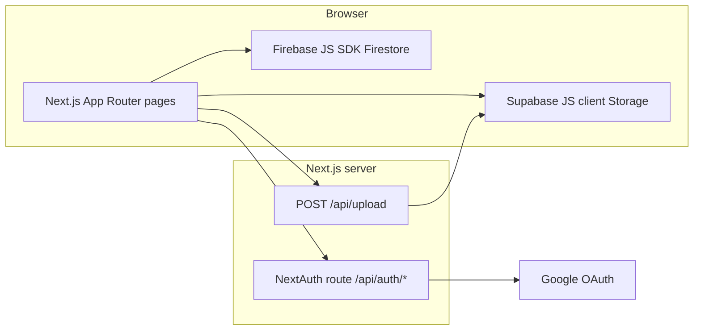

# Rebuild guide: restore backend, auth, and storage (match `main`)

This document explains **everything that was removed** on the `hamad` branch relative to **`main`**, and how to rebuild the app so it behaves like **`main`** again: **NextAuth (Google)**, **Firebase Firestore** for metadata, **Supabase Storage** for blobs, and the **Next.js API route** used for uploads.

Use this as an implementation checklist. File paths are from the repository root. Line-level behavior is derived from `git diff main..hamad` and `git show main:<path>`.

---

## 1. High-level architecture (`main`)



- **Auth:** NextAuth v4 with **GoogleProvider**. Session is available client-side via `useSession` from `next-auth/react`, wrapped in `SessionProvider`.
- **Metadata:** Cloud Firestore collections **`folders`** and **`files`**. Documents are keyed by string IDs (often `Date.now().toString()` at creation). Queries filter by **`createdBy == session.user.email`** and optional **`parentFolderId`** / **`isStarred`**.
- **Binary files:** Supabase Storage bucket **`Cloud App Uploads`**, object path pattern **`public/<storedFileName>`**. The upload API returns a **public URL** and a **stored file name** saved on the Firestore file document as **`imageUrl`** and **`imageName`**.
- **Firebase app init:** Client-side Firebase app + optional Analytics (`Config/FirebaseConfig.js`).

---

## 2. Dependencies (`package.json`)

Re-add to **`dependencies`** (versions as on `main`):

```json
"@supabase/supabase-js": "^2.46.1",
"firebase": "^11.0.1",
"next-auth": "^4.24.10"
```

Run `npm install` (or your package manager equivalent).

---

## 3. Environment variables

Create/update `.env.local` (names reflect **actual usage in `main` code**).

### NextAuth

| Variable | Used where | Notes |
|----------|------------|--------|
| `NEXTAUTH_SECRET` | `app/api/auth/[...nextauth]/route.js` | Required for signing cookies in production. |
| `NEXTAUTH_URL` | (NextAuth convention) | Set to your canonical site URL in production. |

### Google OAuth

| Variable | Used where | Notes |
|----------|------------|--------|
| `NEXT_PUBLIC_GOOGLE_ID` | NextAuth `GoogleProvider.clientId` | **Public** prefix; still treat as sensitive. |
| `NEXT_PUBLIC_GOOGLE_SECRET` | NextAuth `GoogleProvider.clientSecret` | **Misnamed**: client secrets should **not** be `NEXT_PUBLIC_*`. Prefer `GOOGLE_CLIENT_SECRET` and change code when hardening; `main` used `NEXT_PUBLIC_GOOGLE_SECRET`. |

### Firebase (client)

All **`NEXT_PUBLIC_*`** in `Config/FirebaseConfig.js`:

- `NEXT_PUBLIC_FIREBASE_API_KEY`
- `NEXT_PUBLIC_FIREBASE_AUTH_DOMAIN`
- `NEXT_PUBLIC_FIREBASE_PROJECT_ID`
- `NEXT_PUBLIC_FIREBASE_STORAGE_BUCKET`
- `NEXT_PUBLIC_FIREBASE_MESSAGING_SENDER_ID`
- `NEXT_PUBLIC_FIREBASE_APP_ID`
- `NEXT_PUBLIC_FIREBASE_MEASUREMENT_ID`

### Supabase

| Variable | Used where | Notes |
|----------|------------|--------|
| `NEXT_PUBLIC_SUPABASE_URL` | `Config/supabaseClient.js` | |
| `NEXT_PUBLIC_SUPABASE_ANON_KEY` | `Config/supabaseClient.js` | Used in **browser** and **server route** `app/api/upload/route.js`. |

**Security note:** The anon key is public by design but must respect **Storage RLS policies** you configure in Supabase. The `main` upload route uses the **same** anon client server-side; ensure policies allow server uploads or switch to a service role on the server only.

---

## 4. Files to restore exactly from `main` (deleted on `hamad`)

Restore these paths from `main` (e.g. `git checkout main -- <path>`):

| Path | Purpose |
|------|---------|
| `Config/FirebaseConfig.js` | `initializeApp`, conditional Analytics. |
| `Config/supabaseClient.js` | `createClient(supabaseUrl, supabaseAnonKey)`. |
| `Providers/SessionWrapper.js` | Client component: `SessionProvider` wrapping children. |
| `app/api/auth/[...nextauth]/route.js` | NextAuth handler: `GET`/`POST` exports. |
| `app/api/upload/route.js` | `POST` multipart upload to Supabase + JSON `{ url, name }`. |

---

## 5. NextAuth route (`main` behavior)

**File:** `app/api/auth/[...nextauth]/route.js`

- **Providers:** `GoogleProvider` with `clientId` / `clientSecret` from env.
- **Config:** `secret: process.env.NEXTAUTH_SECRET`.
- **Exports:** `export { handler as GET, handler as POST }`.

**Google Cloud Console:** OAuth 2.0 Web client with authorized redirect URI matching NextAuth (typically `{NEXTAUTH_URL}/api/auth/callback/google`).

---

## 6. Upload API (`main` behavior)

**File:** `app/api/upload/route.js`

1. Parse `request.formData()`, read `file` field.
2. Reject with 400 if missing.
3. Build **stored name:** `` `${base}-${Date.now()}-${ext}` `` where `base` is `file.name.split(".")[0]` and `ext` is `file.name.split(".")[1]` (**fragile** if multiple dots or no extension — consider hardening when rebuilding).
4. Upload to Supabase:  
   `supabase.storage.from("Cloud App Uploads").upload(`public/${fileName}`, file, { cacheControl: "3600", upsert: false })`
5. On success, `getPublicUrl(`public/${fileName}`)` and return JSON `{ url: publicUrl, name: fileName }`.

**Supabase dashboard:** Bucket **`Cloud App Uploads`** must exist; public URL generation implies **public** bucket or signed URL strategy — align with your security model.

---

## 7. Root layout change

**File:** `app/layout.js`

On `main`, the tree is:

`SessionWrapper` → folder/file/storage context wrappers → `ChildrenProvider`.

Restore `SessionWrapper` **outside** other providers so `useSession` works everywhere below.

---

## 8. `ChildrenProvider` (`main` behavior)

**File:** `Providers/ChildrenProvider.js`

- Import `useSession` from `next-auth/react`.
- If `status === "authenticated"` **and** `session`: render `SideNavBar` + main grid + `Storage`.
- Else if `status !== "loading"`: render **only** `children` (so `/login` is full viewport without shell).
- Loading state: fragment with no shell until session resolves.

This is **critical** for UX parity with `main`.

---

## 9. Firestore data model

### Collection: `folders`

Written by **`CreateFolderModal`** (`setDoc`):

| Field | Type / notes |
|-------|----------------|
| `id` | String (same as document id). |
| `name` | Folder name. |
| `createdBy` | `session.user.email` |
| `createdDate` | Firestore `Timestamp` / `new Date()` (stored as Firestore timestamp when using SDK). |
| `parentFolderId` | Number or string depending on usage — root uses `0` in queries. **Document id** for folder is string from `Date.now().toString()`. |

**Queries:** `where("createdBy", "==", email)` and `where("parentFolderId", "==", parentId)`.

### Collection: `files`

Written by **`UploadFileModal`** after `/api/upload` succeeds:

| Field | Notes |
|-------|--------|
| `name` | Original file name. |
| `type` | Extension string from `selectedFile.name.split(".").pop()`. |
| `size` | **Number** (bytes) — used for quota math in UI. |
| `modifiedAt` | `lastModified` from `File` object. |
| `id` | Document id string. |
| `createdBy` | Email. |
| `createdDate` | Timestamp. |
| `parentFolderId` | From context (root `0`). |
| `imageUrl` | Public URL from API. |
| `imageName` | **Stored object key basename** returned by API (used for Supabase `public/${imageName}`). |
| `isStarred` | Boolean; default `false`. |

**Queries:**

- Home: `parentFolderId == 0` + `createdBy`.
- Folder page: `parentFolderId == folderId` + `createdBy`.
- Files page: all files for `createdBy`.
- Starred: `isStarred == true` + `createdBy`.
- Storage stats: all `files` where `createdBy == email` (client-side categorization by `type`).

### Indexes

Firestore may require **composite indexes** for multi-`where` queries (e.g. `createdBy` + `parentFolderId`, `createdBy` + `isStarred`). Create them when the console prompts with the provided link.

---

## 10. Supabase Storage usage (`main`)

**Bucket:** `Cloud App Uploads`  
**Object path:** `public/<imageName>`

| Operation | Location |
|-----------|----------|
| Upload | `app/api/upload/route.js` |
| Delete single file | `FileList.deleteFile`, `app/files/page.js`, `app/starred/page.js` — `remove([`public/${imageName}`])` |
| Delete many | `FolderList` / `view-all` when deleting folder contents — per-file `remove` |
| Download | `FileItem.handleDownload` — `storage.from(...).download(`public/${file.imageName}`)` then blob URL |

Ensure **`imageName`** in Firestore always matches the object name produced at upload (including the timestamp-mangled name from the API).

---

## 11. Pages to revert to `main` logic

These files were heavily simplified on `hamad`; restore from `main` or reapply the same patterns:

| File | `main` responsibilities |
|------|-------------------------|
| `app/page.js` | `useSession`, redirect if unauthenticated, Firestore queries for root folders/files, `ParentFolderIdContext` set to `0`, refresh on context flags. |
| `app/login/page.jsx` | `signIn("google")`, `useSession` + redirect to `/` if already signed in, loading placeholder. |
| `app/folder/[id]/page.js` | Session guard, `setParentFolderId(folderId)`, fetch child folders/files for user + folder. |
| `app/folder/view-all/page.js` | Session guard, list all user folders at root, folder delete with recursive Firestore + Supabase cleanup. |
| `app/files/page.js` | Session guard, list all files, delete with Firestore + Supabase. |
| `app/starred/page.js` | Session guard, query `isStarred`, same delete pattern. |
| `app/not-found.js` | `useSession`: unauthenticated → `router.push("/login")`, reset `parentFolderId`. |

### Bugs to fix when restoring from raw `main` (recommended)

1. **`app/folder/[id]/page.js`** — calls `redirect("/login")` but may **omit** `import { redirect } from "next/navigation"`. Add the import or use `router.push` consistently.
2. **`app/folder/view-all/page.js`** — uses `supabase.storage` in `deleteFilesInFolder` but **`main` is missing** `import { supabase } from "@/Config/supabaseClient"`. Add the import or deletion will throw at runtime.

---

## 12. Components to revert to `main` logic

| Component | `main` behavior summary |
|-----------|-------------------------|
| `Components/storage/UserInfo.js` | `useSession`, `signOut()`, Google profile image via `next/image` (needs `domains` / `remotePatterns`). |
| `Components/storage/StorageInfo.js` | Query all user files; sum `size`; bucket into Images/Videos/Documents/Others by extension; `setUsedStorage(totalBytes)` for quota in upload modal; 50 MB cap constant. |
| `Components/folder/CreateFolderModal.js` | `useSession`, `setDoc` to `folders/{docId}`. |
| `Components/file/UploadFileModal.js` | `fetch("/api/upload")`, then `setDoc` to `files/{docId}`; 10 MB per-file max; 50 MB total check vs `usedStorage`. |
| `Components/file/FileList.js` | Firestore delete + Supabase `remove`; sort by `createdDate.toDate()`. |
| `Components/file/FileItem.js` | Supabase download; Firestore merge toggle `isStarred`; open `imageUrl` in new tab. |
| `Components/folder/FolderList.js` | Recursive folder delete, Firestore + Supabase; navigate with query `?name=`; sort folders by `createdDate`. |
| `Components/folder/InnerFolderList.js` | Same delete/navigation patterns inside nested folder view. |

---

## 13. `next.config.mjs`

`main` only listed `lh3.googleusercontent.com` for `next/image`. After restore, either:

- Keep **`ui-avatars.com`** if you still use those URLs anywhere, or  
- Rely solely on Google avatars and remove if unused.

Prefer migrating to **`images.remotePatterns`** if you upgrade Next.js image config.

---

## 14. Firebase Console checklist

1. Create project; enable **Firestore** (Native mode).
2. Deploy **Firestore security rules** that restrict reads/writes to authenticated users — **`main` client code trusts client-side queries**; rules must enforce `request.auth.token.email == resource.data.createdBy` (or equivalent) if you move to Firebase Auth. With **only NextAuth**, the client uses the **Firebase Web API key** without Firebase Auth tokens, so **current `main` pattern is insecure unless rules are wide open** (typical for a student demo). **For production**, use Firebase Auth custom tokens, Admin SDK, or proxy through Next.js API routes.
3. **Analytics:** optional; `FirebaseConfig` loads Analytics when supported.

---

## 15. Google Cloud & NextAuth checklist

1. OAuth consent screen + OAuth client (Web).
2. Authorized JavaScript origins: your dev and prod URLs.
3. Authorized redirect URI: `{origin}/api/auth/callback/google`.
4. `NEXTAUTH_SECRET`: strong random string.

---

## 16. Supabase checklist

1. Project created; URL + anon key in env.
2. Storage bucket **`Cloud App Uploads`**.
3. Policies for **read** (public URLs) / **upload** / **delete** aligned with how the anon key is used in browser + `app/api/upload`.

---

## 17. Verification matrix (after rebuild)

| Scenario | Expected |
|----------|----------|
| Visit `/` logged out | Redirect to `/login`. |
| Sign in with Google | Session present; `UserInfo` shows profile; home loads. |
| Create folder | New doc in `folders` with your email and `parentFolderId`. |
| Upload file | Object in Supabase; doc in `files` with `imageUrl` / `imageName`. |
| Open file | New tab uses public `imageUrl`. |
| Download | Blob download via Supabase `download`. |
| Star toggle | `isStarred` flips in Firestore. |
| Starred page | Lists only starred. |
| Delete file | Firestore doc removed; storage object removed. |
| Delete folder | Nested folders and files removed; storage objects removed. |
| Storage widget | Totals match sum of file `size` fields. |
| Sign out | Session cleared; access to `/` should send user to login again (per `main` guards). |

---

## 18. Fastest way to restore mechanically

From repo root, on a branch where you want full backend back:

```bash
git checkout main -- \
  Config/FirebaseConfig.js \
  Config/supabaseClient.js \
  Providers/SessionWrapper.js \
  Providers/ChildrenProvider.js \
  app/api/auth app/api/upload \
  app/layout.js app/page.js app/login/page.jsx \
  app/not-found.js \
  app/files/page.js app/starred/page.js \
  'app/folder/[id]/page.js' app/folder/view-all/page.js \
  Components/file/FileItem.js Components/file/FileList.js \
  Components/file/UploadFileModal.js \
  Components/folder/CreateFolderModal.js \
  Components/folder/FolderList.js Components/folder/InnerFolderList.js \
  Components/storage/StorageInfo.js Components/storage/UserInfo.js \
  package.json
npm install
```

Then **apply the two bugfixes** in §11 (missing imports), set **§3** env vars, and configure **§14–§16** in cloud consoles.

---

## 19. Optional hardening (not in `main`)

- Move Google client secret to a **server-only** env name; stop using `NEXT_PUBLIC_` for secrets.
- Replace direct Firestore access from the browser with **authenticated API routes** and Admin SDK or security rules tied to verified identity.
- Use **Supabase service role** only on the server for uploads if policies cannot safely allow anon uploads.
- Fix upload filename parsing for extensions with multiple dots.
- Initialize `usedStorage` in `StorageContextWrapper` to **`0`** (number), not `false`.

---

*Generated from comparison of `main` and `hamad` in Cloud Box Storage; use `git diff main..hamad` for the exact historical patch.*
